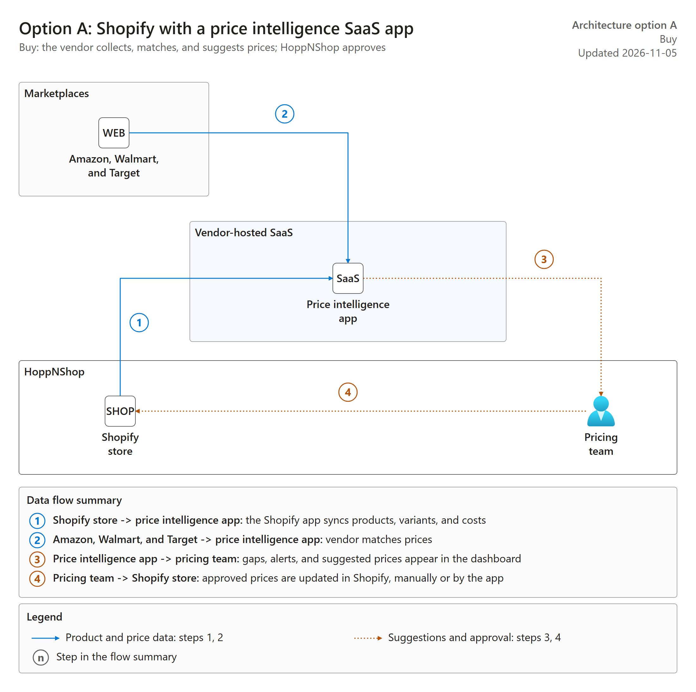
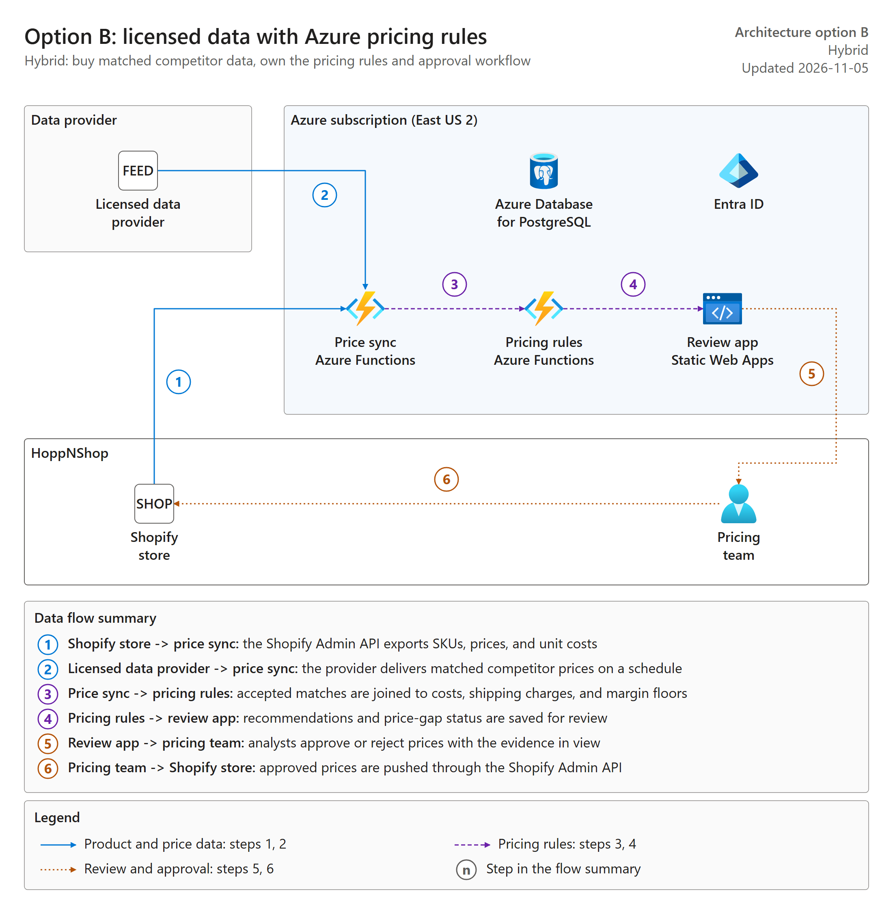
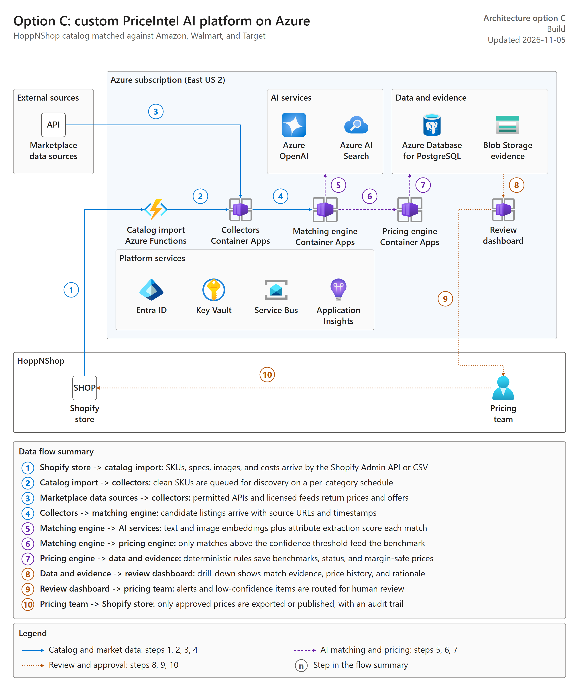

# PriceIntel AI architecture options

Three ways to deliver competitor price intelligence for HoppNShop, from least to most custom. All three keep Shopify as the storefront and keep a human approval step before any price changes.

Status: options for decision. Effort and cost figures are planning estimates to confirm with vendor quotes and the Azure pricing calculator.

## Summary

| | Option A: buy | Option B: hybrid | Option C: build |
|---|---|---|---|
| What you get | Shopify store with a price intelligence SaaS app | Licensed matched data feed with your own pricing rules on Azure | Custom PriceIntel AI platform on Azure |
| Who matches products | The SaaS vendor | The data provider | Your AI matching engine |
| Who owns pricing rules | The vendor's rule options | You (margin floor, shipping, rounding) | You |
| Time to pilot | About 2–4 weeks | About 6–8 weeks | About 10–12 weeks |
| Build effort | Configuration only | About 18–24 person-weeks | About 46 person-weeks |
| Azure running cost | None | About $50–250 a month | About $150–4,000 a month, by scale |
| Data cost | Included in the subscription | Provider fee per SKU or refresh | Provider and API fees |
| Can you resell it as SaaS | No | Only if the data license allows it | Yes, with option C multi-tenancy |
| Main risk | Weak coverage for unbranded or private-label products | Provider coverage and license terms | Build cost and data access |

## Option A: buy a price intelligence SaaS app

Alt text: The Shopify store syncs products to a vendor-hosted price intelligence app, which also collects prices from Amazon, Walmart, and Target. The app shows suggestions to the pricing team, who update approved prices in Shopify.

1. Shopify store -> price intelligence app: the Shopify app syncs products, variants, and costs.
2. Amazon, Walmart, and Target -> price intelligence app: the vendor collects and matches competitor prices.
3. Price intelligence app -> pricing team: price gaps, alerts, and suggested prices appear in the vendor dashboard.
4. Pricing team -> Shopify store: approved prices are updated in Shopify, manually or by the app.

Choose it when you want results fast, your categories are well covered by a vendor, and you don't plan to sell the tool to others. Candidate vendors to trial include Prisync, Price2Spy, DataWeave, and Intelligence Node. Confirm each vendor's coverage of Amazon, Walmart, and Target listings in your categories during the trial.

Files: [option-a-buy-saas.drawio](./option-a-buy-saas.drawio), [option-a-buy-saas.svg](./option-a-buy-saas.svg), [option-a-buy-saas.json](./option-a-buy-saas.json).

## Option B: licensed data with Azure pricing rules

Alt text: A licensed data provider and the Shopify store feed a price sync function in Azure. A pricing rules function applies margin, shipping, and rounding rules, and a review app built on Static Web Apps shows recommendations to the pricing team, who push approved prices back to Shopify. Azure Database for PostgreSQL stores the data and Entra ID handles sign-in.

1. Shopify store -> price sync: the Shopify Admin API exports SKUs, prices, and unit costs.
2. Licensed data provider -> price sync: the provider delivers matched competitor prices on a schedule.
3. Price sync -> pricing rules: accepted matches are joined to costs, shipping charges, and margin floors.
4. Pricing rules -> review app: recommendations and price-gap status are saved for review.
5. Review app -> pricing team: analysts approve or reject prices with the evidence in view.
6. Pricing team -> Shopify store: approved prices are pushed through the Shopify Admin API.

Choose it when a vendor's data is good but its pricing logic doesn't fit your cost, shipping, or approval rules. You own the deterministic pricing engine and the audit trail, but not the matching.

Files: [option-b-hybrid.drawio](./option-b-hybrid.drawio), [option-b-hybrid.svg](./option-b-hybrid.svg), [option-b-hybrid.json](./option-b-hybrid.json).

## Option C: custom PriceIntel AI platform on Azure

Alt text: The full custom design. The Shopify store feeds catalog import, collectors gather permitted marketplace data, a matching engine uses Azure OpenAI and Azure AI Search, a pricing engine saves recommendations to Azure Database for PostgreSQL and Blob Storage, and a review dashboard routes them to the pricing team, who approve the prices that return to Shopify.

This is the full custom design, with the Shopify store as the catalog source and publishing target. The [interactive mockup](../../index.html) shows what its review dashboard could look like.

Choose it when options A and B fail the pilot on matching accuracy or coverage for your categories, or when you want to sell PriceIntel to other businesses.

Files: [option-c-build.drawio](./option-c-build.drawio), [option-c-build.svg](./option-c-build.svg), [option-c-build.json](./option-c-build.json).

## Recommended path

1. Move or keep the store on Shopify.
2. Trial two or three option A vendors on the same 100–200 pilot SKUs. Measure matching precision against a labeled set, coverage by marketplace and category, and cost per SKU.
3. If the data is good but the pricing logic doesn't fit, move to option B.
4. Build option C only if no vendor meets the pilot targets, or if a SaaS business is part of the plan.

The options build on each other. The pricing rules and review app from option B become the pricing engine and dashboard in option C, so moving from B to C reuses that work.
